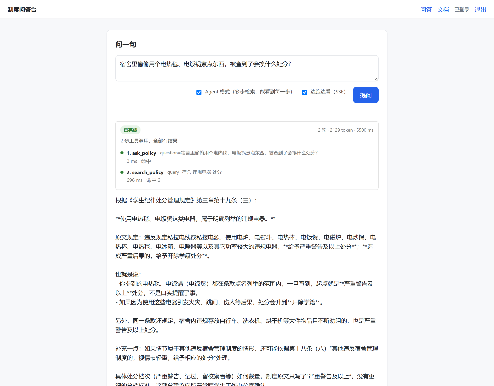

# AI 应用案例：PolicyDesk —— 制度问答 Agent

**周语昕 ｜ 独立开发 ｜ 2026.09 – 2026.11 ｜ 求职方向：AI 应用开发（实习）**

---

## 一、做了什么（解决什么问题）

员工和学生查制度（请假谁批、报销比例、处分等级、年假折算）通常要翻 PDF，答案没有出处，
用通用大模型问又容易编。**PolicyDesk** 解决三件事：

1. **自己查**：Agent 决定查几次、查什么（不是固定一条检索管线）；
2. **有出处**：每条答案下面给原文条款，可核对；
3. **不编**：库里没有资料就明确拒答，并说明"查不到"。

前端实时显示每一步（工具、参数、耗时、命中几条），过程不可信时答案不算数。

## 二、用了什么工具、怎么用

**AI 编程工具**：Claude Code 类 CLI Agent（日常写实现、排错、生成测试）。
**技术栈**：Python + FastAPI · Java 17 / Spring Boot 3 · Vue 3 + TypeScript · MySQL 8 + Redis ·
Docker Compose。

**我怎么用它**（不是"让它写我复制"）：

- 先定约束：项目里放规则文件与模板，让它按既有风格改，而不是另起一套；
- 先写测试再改逻辑，改完我自己读 diff，跑不通就回退；
- 关键判断自己做：下面这个例子能说明"审查"具体长什么样。

**一个真实的审查例子**：Java 要透传 SSE，AI 给的方案是 `RestClient.exchange` 拿 `InputStream`。
照它写完跑出 500，报 `stream is closed`。我判断是**回调一结束流就被关**，先试 `Supplier` 只推迟了
打开、救不了流本身；换成 JDK `java.net.http.HttpClient` 的 `BodyHandlers.ofInputStream()`
才拿到活的流。这类问题只能靠读源码与实测，不能靠信。

**AI 平台**：用过 Dify / Coze 搭原型（拖拽工作流、挂知识库），也用过飞书开放平台——
项目里有飞书知识库（Wiki）只读连接器：tenant_access_token 换取、节点分页拉取、错误码映射，
带测试；但正式落地没走平台，而是手写 Agent 循环 + 自建评测门禁（平台做不了「改一版会不会变差」）。

## 三、结果怎么样

| 指标 | 结果 | 出处 |
|---|---|---|
| gold 条款命中 | **42/44** | 105 题盲出独立集，`eval/reports/agent-baseline.md` |
| 拒答率 | **40/61** | 同上 |
| 与同刻 `/chat` 对比 | 打平（1 胜 2 负，均在噪声带内） | 配对 + exact McNemar |
| 测试 | 63 后端 + 16 前端 + 541 算法层 | pytest / vitest / `@Test` 计数 |
| CI | 3 个 job 全绿（java 22s / web 15s / deploy 14s） | GitHub Actions 实测 |
| 门禁拦下的真实退化 | 改写问法可绕过拒答，修复后 **26/61 → 40/61** | 实验记录 |
| 自动化收益 | 105 题跑批约 **25 分钟**，报告与对照表自动生成 | 实测 |

**交付形态**：Docker Compose 五容器（web / api / ai / mysql / redis）、Nginx 反向代理、
Cloudflare Tunnel 对外；两个仓库 CI 均绿。

**仓库**：`github.com/inwardzyx/policy-desk`（全栈应用） · `github.com/inwardzyx/campus-policy-rag`（检索与评测）

---

## 30 秒口述版（面试让讲实现过程时用）

> "我用 Claude Code 类工具写代码，但关键判断自己做。比如 Java 那段 SSE，AI 给的 `RestClient`
> 方案跑出来 500、报 `stream is closed`，我判断是回调一结束流就被关，换成 JDK `HttpClient` 的流才活。
> 项目现在的门禁是 105 题盲出集：先量噪声地板，再上 exact McNemar；它拦下过一次真实退化——
> 改写问法能绕过拒答，修完拒答从 26/61 到 40/61。"
